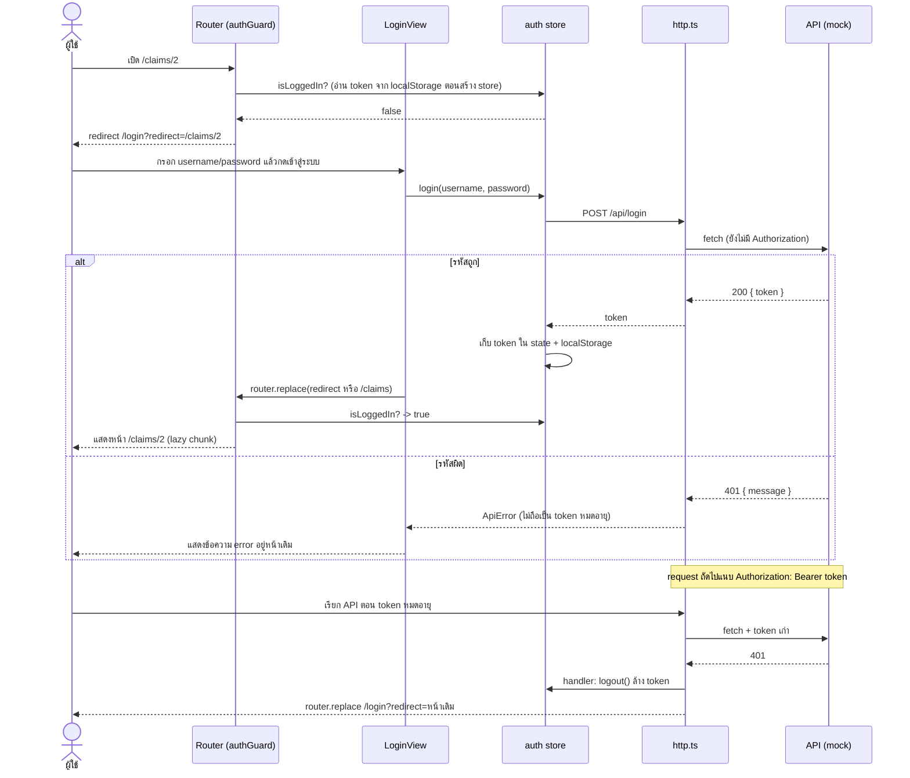

# Day 2 — Vue 3 ขั้นกลาง: Claim Console

ต่อยอดจากโค้ด Day 1: หน้าตา layout และ component (`BaseButton`, `SearchBox`, `ClaimForm`, `ClaimItem`, `ClaimList`, `ThemeToggle`, `styles.css`) ยกมาจาก `day01-vue-basics` สิ่งที่เปลี่ยนคือย้าย state จาก `ref` ใน `App.vue` ไปไว้ใน Pinia, เพิ่ม router, ชั้น API และ composable

แอป 3 หน้า (รายการ / รายละเอียด / ฟอร์ม) + หน้า login ใช้ Vue Router + Pinia + composable ต่อ mock API ข้อมูลทั้งหมดเป็นข้อมูลสมมติ

## วิธีรัน

```bash
npm install
npm run dev       # เปิดพร้อม mock API (/api/*) ใน Vite
npm test          # unit test + baseline (Vitest)
npm run build     # type-check + build (route แยก chunk)
```

ต้องใช้ Node.js 20.19 ขึ้นไป บัญชีสาธิต: `demo` / `demo1234`

ต่อ API จริง (เช่น Go) แทน mock: `VITE_API_TARGET=http://localhost:8080 npm run dev` จะปิด mock แล้ว proxy `/api` ไปที่ target

## โครงสร้าง

```
src/
  api/          http.ts (fetch + ApiError + token), claimsApi.ts
  composables/  useFetch, usePagination, useToast (provide/inject)
  stores/       auth.ts, claims.ts (Pinia)
  router/       routes + authGuard + lazy loading, session.ts (จัดการ 401)
  views/        Login, ClaimList, ClaimDetail, ClaimForm, NotFound
  components/   BaseButton, SearchBox, ClaimForm, ClaimItem, ClaimList, ThemeToggle (จาก Day 1)
  types/        claim.ts
mock-api/       mockApi.ts (logic ล้วน ทดสอบได้) ← เสียบเข้า Vite เป็น middleware
tests/          unit + baseline
```

## ใช้ local state / composable / Pinia ตรงไหน เพราะอะไร

| ที่ | แบบที่ใช้ | เหตุผล |
|---|---|---|
| ค่าในฟอร์ม (`ClaimFormView`), error ของ login | local state (`ref`/`reactive`) | ใช้แค่ในหน้าเดียว ไม่มีใครอื่นต้องรู้ |
| `usePagination` | composable | logic แบ่งหน้าใช้ซ้ำได้ state แยกต่อ instance (แต่ละรายการมีหน้าของตัวเอง) |
| `useFetch` | composable | จัดการ loading/error/refresh แพทเทิร์นเดียว ใช้กับ endpoint ไหนก็ได้ |
| รายการเคลม, keyword, filter | Pinia `claims` | list / detail / form ใช้ข้อมูลชุดเดียวกัน ต้องไม่โหลดซ้ำและแก้ที่เดียวหน้าอื่นเห็น |
| token / สถานะ login | Pinia `auth` | router guard และ header ต้องอ่านค่าเดียวกัน อยู่นอก component |
| toast | `provide`/`inject` | ส่ง service ลงไปหลายชั้นโดยไม่ต้องส่ง props ไม่ใช่ข้อมูลธุรกิจ จึงไม่ต้องใช้ store |

หลักที่ใช้เลือก: ถ้าใช้หน้าเดียวให้ local state, ถ้าเป็น logic ที่อยากใช้ซ้ำให้ composable, ถ้าหลายหน้า/หลายส่วนต้องเห็นข้อมูลเดียวกันให้ Pinia

## สิ่งที่เปลี่ยนจาก Day 1

| Day 1 | Day 2 |
|---|---|
| `claims`, `keyword`, `statusFilter` เป็น `ref` ใน `App.vue` | อยู่ใน Pinia store `claims` (หลายหน้าใช้ร่วมกัน) |
| ข้อมูลเป็นอาร์เรย์ในโค้ด | เรียกผ่านชั้น `api/` (mock API หรือ API จริง) มี loading/error |
| หน้าเดียว | 3 หน้า + login ผ่าน Vue Router (guard, lazy) |
| ฟอร์มอยู่ในหน้าเดียวกับรายการ | แยกเป็นหน้า `/claims/new` ใช้ `ClaimForm` ตัวเดิม |
| `ClaimItem` แสดงรหัสผู้ป่วยเฉยๆ | รหัสผู้ป่วยเป็นลิงก์ไปหน้า detail |

## Flow การ login



ลำดับตามโค้ด

1. `authGuard` (`router/index.ts`) เช็ก `auth.isLoggedIn` ถ้ายังไม่ login ไป `/login?redirect=<path เดิม>`
2. `LoginView` เก็บ username/password เป็น local state เรียก `auth.login()`
3. `auth.login()` เรียก `authApi.login` -> `http()` ยิง `POST /api/login`
4. สำเร็จ: เก็บ token ใน state และ localStorage (`day02-token`) ผิด: `ApiError` แสดงใต้ฟอร์ม
5. `LoginView` redirect ไปปลายทางเดิม รับเฉพาะ path ภายในที่ขึ้นต้นด้วย `/`
6. ทุก request ต่อไป `http()` แนบ `Authorization: Bearer <token>`
7. ถ้าได้ 401 จากที่อื่นนอกจาก `/api/login` (`router/session.ts`) จะ `logout()` แล้วกลับหน้า login พร้อมจำหน้าเดิม ชั้น `http.ts` ไม่ import store/router แต่รับ handler ผ่าน `setUnauthorizedHandler` เพื่อไม่ให้ชั้น API ผูกกับ UI
8. รีเฟรชหน้า: store อ่าน token จาก localStorage จึงยังอยู่ในระบบ

## Router

- `authGuard` (`beforeEach`): ยังไม่ login ไป `/login?redirect=...`, login แล้วเข้า `/login` จะเด้งไป `/claims`
- dynamic route `/claims/:id(\d+)` ส่ง `id` เป็น props (แปลงเป็น number) ถ้าไม่ใช่ตัวเลขไป not-found
- ทุกหน้าโหลดแบบ lazy (`() => import(...)`) ดู output ของ `npm run build` จะเห็นแยก chunk
- หลัง login จะ redirect เฉพาะ path ภายใน (ขึ้นต้นด้วย `/`) กัน open redirect

## ข้อสังเกต

- composable ที่สร้าง state ใน function = แยกต่อ instance, state นอก function = singleton ร่วมกัน (ในแอปนี้ shared state ไปอยู่ใน Pinia แทนเพื่อให้เห็นชัดและ debug ผ่าน DevTools ได้)
- เจอ 401 กลางทางจะ logout และกลับหน้า login อัตโนมัติ (ดูหัวข้อ Flow การ login)
- token เก็บใน localStorage เพื่อสาธิตเท่านั้น งานจริงควรใช้ httpOnly cookie
- `storeToRefs` ใช้กับ state/getter, ส่วน action เรียกจาก store ตรงๆ

## ภาพหน้าจอ

| ไฟล์ | สถานะ |
|---|---|
| `01-login-redirect.png` | เปิด /claims ตอนยังไม่ login ถูกส่งมาหน้า login |
| `02-login-wrong.png` | กดเข้าสู่ระบบโดยไม่กรอก แสดง error จาก API |
| `03-list.png` | รายการเคลมหลัง login |
| `04-search.png` | ค้นหา "รพ.ตัวอย่าง A" |
| `05-detail.png` | หน้ารายละเอียดเคลม |
| `06-form-validation.png` | ฟอร์มเพิ่มเคลม กดส่งโดยไม่กรอก |
| `07-added-detail.png` | เพิ่มเคลมแล้วไปหน้า detail พร้อม toast |
| `08-dark.png` | dark mode |
| `09-not-found-claim.png` | เปิดเคลมที่ไม่มี (API ตอบ 404) |

## Unit test

Vitest + @vue/test-utils + jsdom (74 เทสต์)

| ไฟล์ | ทดสอบอะไร |
|---|---|
| `mockApi.test.ts` | login, 401, CRUD, validate, แยกข้อมูลต่อ instance |
| `http.test.ts` | แนบ token, แปลง ApiError, 204, URL/method ของ `claimsApi` |
| `components.test.ts` | component ที่ยกมาจาก Day 1 ยังทำงานเหมือนเดิม (ClaimForm, ClaimItem, ClaimList, SearchBox) |
| `ThemeToggle.test.ts` | ปุ่มสลับธีม (จาก Day 1) |
| `composables.test.ts` | useFetch (สำเร็จ/ล้มเหลว/immediate/แยก instance), usePagination, useToast |
| `stores.test.ts` | claims store (load, getters, add/change/remove), auth store |
| `session.test.ts` | 401 กลางทาง: เรียก handler, ยกเว้น /api/login, logout + redirect กลับหน้าเดิม |
| `router.test.ts` | guard, redirect query, dynamic route, lazy, document.title |
| `views.test.ts` | Login, List (error/retry/ค้นหา/กรอง/แบ่งหน้า), Detail, Form |
| `baseline.test.ts` | baseline: ตาราง route, state เริ่มต้นของ store, snapshot ทุกหน้า |

กติกา: แก้โค้ดทุกครั้งต้องเพิ่ม/แก้เทสต์ของส่วนนั้น ถ้า baseline แดงและตั้งใจให้เปลี่ยน ให้รัน `npm run test:update` แล้วดู diff ของ snapshot ก่อน commit
