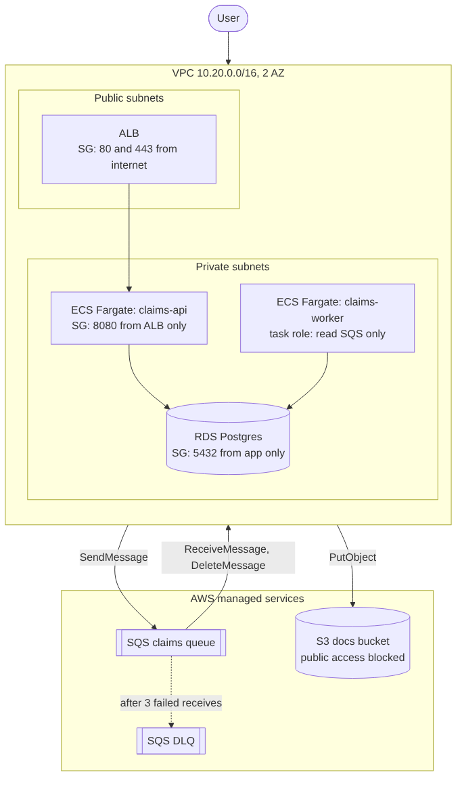

# Day 7: Terraform + AWS

S3 bucket + SQS queue (พร้อม DLQ) + IAM แบบ least privilege เขียนด้วย Terraform รันบน LocalStack จึงไม่เสียเงินและไม่ต้องมีบัญชี AWS และมี VPC (2 AZ, public/private) ไว้ฝึกอ่าน `terraform plan`



diagram คือสถาปัตยกรรมเป้าหมายบน AWS (ECS Fargate + RDS + SQS + S3) โค้ดวันนี้สร้างเฉพาะส่วน S3/SQS/IAM (`infra/`) และ network/security group (`infra-vpc/`, plan อย่างเดียว) ส่วน ECS และ RDS ยังไม่ได้เขียน เพราะมีค่าใช้จ่ายและเป็นงานต่อยอด

## โครงสร้าง

```
docker-compose.yml        LocalStack 3.8 (S3, SQS, IAM, STS, EC2) พอร์ต 4566
infra/                    S3 + SQS (module queue) + IAM
  modules/queue/          queue หลัก + DLQ + redrive policy
infra-vpc/                VPC, subnet, route table, security group (plan อย่างเดียว)
notes/                    aws-concepts.md, terraform-cheatsheet.md, exercises.md
docs/                     architecture.mmd / .png
scripts/run-all.bat       รันทุกอย่างบนเครื่องจริงแล้วเขียน notes/run-results.md
tests/test_terraform.py   เทสต์ตรวจไฟล์ (ไม่ต้องมี terraform)
testdata/baseline.json    รายการ resource และ action ที่คาดไว้
```

## ลองเอง

ต้องการ Docker Desktop อย่างเดียว (terraform และ AWS CLI รันเป็น container)

```
scripts\run-all.bat
```

หรือทีละขั้น ถ้าติดตั้ง terraform บนเครื่องแล้ว:

```
docker compose up -d
cd infra
terraform init
terraform plan -var-file=example.tfvars
terraform apply -var-file=example.tfvars
terraform destroy -var-file=example.tfvars
cd ..\infra-vpc && terraform init && terraform plan
docker compose down -v
```

ใช้ AWS จริง: ตั้ง `use_localstack=false`, ใส่ credential ผ่าน environment, ตั้ง billing alarm ก่อน และ `terraform destroy` ทุกครั้ง ตรวจ pricing ล่าสุดก่อนสร้าง

## สถานะการตรวจสอบ

- เทสต์ใน `tests/` (28 ข้อ) รันผ่านด้วย `python3 -m unittest discover -s tests` เป็นการตรวจโครงสร้างไฟล์ เช่น S3 ปิด public ครบ 4 ค่า, DLQ มี redrive, IAM ไม่มี wildcard, consumer ส่ง message ไม่ได้, private route table ไม่มี default route, ไม่มี credential ในไฟล์
- รัน `scripts\run-all.bat` บนเครื่องจริง (Docker Desktop, terraform 1.9 ใน container, AWS provider 5.100, LocalStack 3.8) ผ่านครบ 18 ขั้น: fmt, init, validate, plan, apply (10 resources), plan ซ้ำไม่มีการเปลี่ยนแปลง, ตรวจด้วย AWS CLI (public access block, versioning, redrive policy, ส่ง/รับ message, IAM policy), destroy (10 resources) และ VPC validate/plan (15 resources, ไม่ apply) ผลเต็มอยู่ใน `notes/run-results.md`
- ทดสอบกับ LocalStack เท่านั้น ยังไม่ได้ apply กับ AWS จริง

## ข้อจำกัด

- ไม่ได้ตั้ง remote state (ตัวอย่างอยู่ใน `notes/terraform-cheatsheet.md`) state เก็บในเครื่องและถูก ignore ใน git
- ไม่มี NAT Gateway ใน VPC เพราะคิดเงินรายชั่วโมง ถ้า service ใน private subnet ต้องออกอินเทอร์เน็ตให้เพิ่มเอง หรือใช้ VPC endpoint
- LocalStack จำลองพฤติกรรมของ AWS ไม่ครบทุกอย่าง โดยเฉพาะ IAM ไม่บังคับใช้ policy แบบ AWS จริง จึงตรวจได้แค่ว่า resource ถูกสร้างตามที่เขียน
