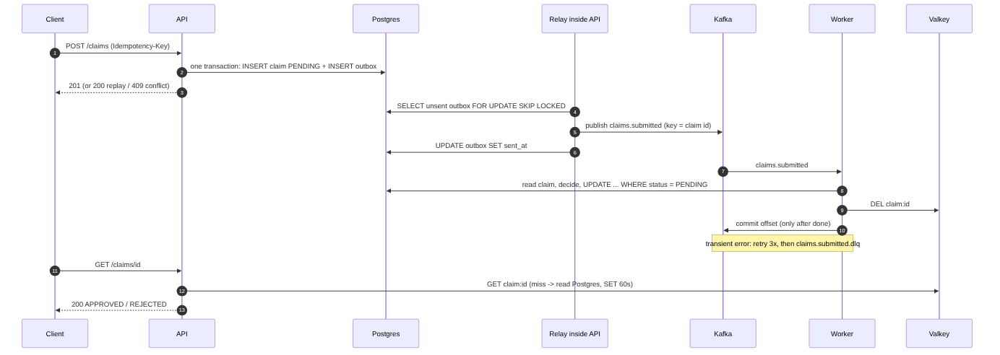

# Day 8 - Capstone backend: Claim Tracker Lite

Go + Postgres + Valkey (Redis) + Kafka ใช้ข้อมูลปลอมเท่านั้น

`POST /claims` บันทึก claim เป็น PENDING แล้วส่ง event เข้าคิว worker อ่าน event มาตัดสินเป็น APPROVED หรือ REJECTED แล้วอ่านผลกลับผ่าน GET โดยมี cache คั่นหน้า

## สถานะของโค้ดนี้ (อ่านก่อน)

| ส่วน | สถานะ |
|---|---|
| domain / service / consumer / relay / HTTP handler | มี unit test ผ่าน `go test ./... -race` |
| adapter ของ Postgres / Kafka / Redis, cmd/api, cmd/worker | compile ผ่าน (`go vet ./...` ผ่าน) และรันใน Docker ได้ |
| end to end (compose, Kafka, outbox, DLQ, shutdown) | `scripts\run-all.ps1` รันบนเครื่องจริง ผ่าน 25/25 ขั้น ดู `notes/run-results.md` |

สิ่งที่ยังไม่ได้ครอบคลุม: ไม่มี load test, ไม่เคยรันหลาย instance (หลาย API relay หรือหลาย worker), การรันใน Docker ใช้ Kafka broker ตัวเดียว และ Python test เป็นการตรวจแบบ static เท่านั้น

## วิธีรัน

```
cd day08-backend
scripts\run-all.bat          # build, ยกทุกอย่างขึ้น, ตรวจ, เขียน notes\run-results.md แล้ว tear down
scripts\run-all.ps1 -Keep    # เหมือนกันแต่ปล่อย stack ไว้
```

หรือรันเองทีละคำสั่ง (ต้อง `go mod tidy` ครั้งเดียวเพื่อสร้าง go.sum):

```
docker run --rm -v "%CD%:/src" -w /src golang:1.25 go mod tidy
docker compose up -d --build
curl -X POST localhost:8080/claims -H "Idempotency-Key: demo-1" -H "Content-Type: application/json" -d "{\"patient_ref\":\"FAKE-AB12\",\"amount\":150000}"
curl localhost:8080/claims/<id>
curl "localhost:8080/claims?status=APPROVED&limit=10"
docker compose down -v
```

เทสต์โดยไม่ใช้ Docker: `go test ./... -race` (Go 1.24+) และ `python -m unittest discover -s tests`

## API

| คำสั่งเรียก | ผลลัพธ์ |
|---|---|
| `POST /claims` body `{"patient_ref":"FAKE-AB12","amount":150000}` + header `Idempotency-Key` | 201 สร้างสำเร็จ สถานะ PENDING ถ้า key เดิม + body เดิม: 200 พร้อม `Idempotent-Replayed: true` และ id เดิม ถ้า key เดิม + body ต่าง: 409 ไม่มี key หรือ body ผิด: 400 |
| `GET /claims/{id}` | 200, 404, หรือ 400 ถ้า id ไม่ใช่ uuid |
| `GET /claims?status=PENDING&limit=20&offset=0` | `{items, limit, offset}` limit 1..100 (ค่าเริ่มต้น 20) เรียงใหม่สุดก่อน |
| `GET /healthz`, `GET /readyz` | liveness (ไม่พึ่ง dependency) / readiness (ping Postgres) |

`amount` เป็นจำนวนเต็มหน่วยสตางค์ (หน่วยย่อย) ไม่ใช้ float `patient_ref` ต้องตรงกับ `FAKE-[A-Z0-9]{3,12}` ตรวจทั้งใน Go และด้วย CHECK ใน Postgres เพื่อไม่ให้เผลอเก็บรหัสจริงลงไป

กฎการตัดสิน (จำลอง): amount เกิน 5,000,000 สตางค์ (50,000 บาท) จะ REJECTED (`over_limit`) นอกนั้น APPROVED ส่วน `FAKE-POISON` จะล้มตอนประเมินทุกครั้ง ไว้สาธิต retry และ DLQ

## โครงสร้าง

```
cmd/api        REST + outbox relay          cmd/worker   Kafka consumer
internal/domain    Claim, กฎสถานะ, Evaluate (ไม่มี I/O)
internal/service   Claims (submit/get/list/process), Consumer (retry+DLQ), Relay (outbox)
internal/port      interface: ClaimRepository, EventPublisher, Cache
internal/adapter   http (net/http) / postgres (pgx) / kafka (kafka-go) / redis (go-redis)
internal/memory    ตัวปลอมแบบ in-memory ของ port ใช้ในเทสต์
migrations/        ไฟล์ golang-migrate    docs/  sequence diagram
```

service พึ่งพาเฉพาะ interface ใน `port` ทุก use case จึงเทสต์ด้วยตัวปลอมได้ และมี Python test ตรวจว่า service กับ domain ไม่เคย import adapter



## การตัดสินใจเรื่องดีไซน์

- **ใช้ outbox แทน dual write** บันทึกลง Postgres แล้วค่อยเรียก Kafka อาจตายกลางทางได้ API จึงเขียน claim กับแถว `outbox` ใน transaction เดียว แล้วให้ relay (goroutine ใน API) ส่งแถวที่ยังไม่ได้ส่ง ถ้าล้มหลังส่งแต่ก่อนมาร์กว่าส่งแล้ว event จะออกสองครั้ง ซึ่งไม่เป็นไรเพราะ consumer เป็น idempotent
- **Idempotency key** ใช้ unique index บน `idempotency_key` บวก hash ของ request และ `INSERT ... ON CONFLICT DO NOTHING` ทำให้ request ซ้ำที่เข้ามาพร้อมกันปลอดภัย (ทดสอบด้วยการ submit 20 ตัวขนานกันใน fake)
- **Consumer เป็น idempotent** อ่าน claim ใหม่ทุกครั้ง ข้ามอันที่ไม่ใช่ PENDING แล้ว และอัปเดตด้วย `WHERE status = 'PENDING'` event เก็บแค่ id ของ claim ไม่เก็บสำเนาข้อมูล
- **Retry แล้วค่อย DLQ** ลองสูงสุด 3 ครั้ง backoff 0.5 วิ / 1 วิ สำหรับ error ชั่วคราว ส่วน error ถาวร (payload เสีย, ไม่รู้จัก claim) ไป `claims.submitted.dlq` ทันที พร้อมเหตุผล topic เดิม key และ value ข้อความถือว่าเสร็จเมื่อประมวลผลสำเร็จหรือถูกพักไว้ใน DLQ แล้ว
- **Commit offset หลังทำงานเสร็จ** ถ้า handler ยังล้ม (เช่น ส่งเข้า DLQ ไม่ได้) adapter จะลองข้อความเดิมซ้ำแทนที่จะข้ามไป เพื่อไม่ให้ commit ครั้งถัดไปข้ามข้อความนั้น เมื่อได้ SIGTERM ข้อความที่กำลังทำอยู่จะทำให้เสร็จก่อน
- **Cache เป็นแบบ best effort** error จาก Valkey ถูก log และนับเป็น miss claim ตาม id: TTL 60 วินาที และลบทิ้งเมื่อ worker เปลี่ยนสถานะ รายการ list: TTL 10 วินาที ไม่ invalidate
- **เลือก kafka-go** เพราะ API เล็ก ถ้าอยากคุมได้มากและเร็วกว่าให้ใช้ franz-go Kafka รันโหมด KRaft (ไม่มี ZooKeeper) ปิด topic auto-create และให้ `kafka-init` สร้าง 3 partition บวก 1 สำหรับ DLQ
- **ใช้ pgx ตรงๆ** (ไม่ใช้ sqlc) เพื่อให้เห็น query ชัด มีประมาณ 6 query

## ข้อจำกัดที่รู้

- Relay รันอยู่ในทุก API instance ปลอดภัย (SKIP LOCKED) แต่การ poll ทุก 500 ms ไม่ประหยัด ขั้นต่อไปคือแยก relay เป็นอีก process หรือใช้ Postgres LISTEN/NOTIFY หรือ CDC
- Kafka ส่งแบบ at-least-once ไม่มี exactly-once ที่ยอมรับได้เพราะ consumer เป็น idempotent
- poison message จะบล็อก partition ของมันระหว่าง retry พอครบ 3 ครั้งจึงย้ายไป DLQ ตอนนี้ยังไม่มีอะไรอ่าน DLQ และไม่มีเครื่องมือ replay
- poison claim จะค้างเป็น PENDING ตลอด ไม่มีสถานะ `FAILED` และไม่มี flow ให้คนตรวจเอง
- cache ของ list อาจเก่าได้ถึง 10 วินาทีหลังมี claim ใหม่ ส่วน cache แบบตาม id มี race เล็กน้อย: read ที่เริ่มก่อน worker อัปเดต อาจเขียนค่าเก่ากลับหลัง worker ลบ key ไปแล้ว ทำให้เก่าได้ถึง 60 วินาที
- Pagination เป็น limit/offset หน้าลึกจะช้า และข้ามหรือซ้ำแถวได้ถ้าข้อมูลเปลี่ยน แก้ได้ด้วย keyset pagination (created_at, id)
- Idempotency key เป็น global ไม่แยกตาม client และไม่หมดอายุ
- ไม่มี auth, rate limit, metrics หรือ tracing (ไว้ Day 10) compose ใช้ credential ของ DB แบบทิ้งได้ สำหรับรันในเครื่องเท่านั้น
- ที่ไม่ได้ทำจากรายการ optional: gRPC `GetClaim`, integration test ด้วย testcontainers ใช้สคริปต์ compose run ครอบ integration path แทน

## เทสต์

| ที่ไหน | ตรวจอะไร |
|---|---|
| `internal/domain` | validation table, transition, กฎการตัดสิน, hash, uuid |
| `internal/service` | idempotency (เดิม / ต่าง / พร้อมกัน), outbox relay (broker ล่ม, ลำดับ), process แบบ idempotent เมื่อ redeliver, retry แล้วสำเร็จ, poison ไป DLQ, payload เสีย, error ถาวรไม่ retry, DLQ ล้มแล้วไม่ commit, shutdown หยุด retry, cache hit/invalidate/ล่ม, pagination |
| `internal/adapter/http` | status code, จำกัดขนาด body, ไม่รั่วรายละเอียด error ภายใน, readyz 503, liveness ไม่ขึ้นกับ DB |
| `internal/baseline` + `testdata/baseline.json` | snapshot ของการตัดสิน, transition, ขีดจำกัด, topic, HTTP code ถ้าตั้งใจให้ล้ม: `go test ./internal/baseline -update` |
| `tests/test_infra.py` | compose, migration เทียบกับค่าคงที่ใน Go, Dockerfile, กฎ import, commit หลัง handler, ใช้ข้อมูลปลอมเท่านั้น |
| `scripts/run-all.ps1` | ของจริง: compile, up, พฤติกรรม API, approve/reject แบบ async, cache, DLQ, Kafka ล่มแล้วกลับมา, ปิดแบบ graceful |

Mutation check ที่ทำใน sandbox: ถ้าทำลายกฎ over-limit, การเช็ก idempotency conflict, การข้ามอันที่ "ประมวลผลแล้ว", กฎ error ถาวร หรือการ invalidate cache อย่างใดอย่างหนึ่ง เทสต์จะล้มทุกครั้ง
