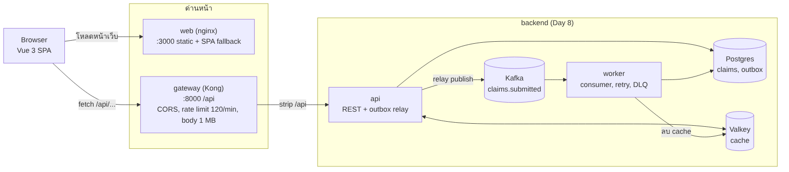
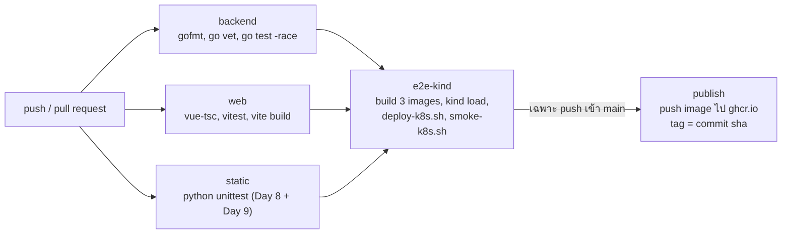

# Day 9 - Capstone: Frontend + Gateway + CI/CD

ต่อจาก Day 8 (`../day08-backend`): เพิ่มหน้าเว็บ Vue 3, API gateway (Kong) และ pipeline CI/CD ใช้ข้อมูลปลอมเท่านั้น



## สถานะของโค้ดนี้ (อ่านก่อน)

| ส่วน | สถานะ |
|---|---|
| frontend `web/` | `vue-tsc` ผ่าน, `vitest` 104 ข้อผ่าน, `vite build` ผ่าน (รันทั้งในเครื่องที่เขียนและใน Docker บนเครื่องจริง) |
| เทสต์ static `tests/test_infra.py` | 52 ข้อผ่าน (kong, compose, nginx, k8s, CI, ความตรงกับ backend) |
| compose + gateway + web ใน Docker | รันจริงแล้วผ่านทุกขั้นของ `scripts\run-all.ps1` ดู `notes/run-results.md` (ประวัติรอบก่อนหน้าที่ล้มอยู่ใน `run-results-round1.md`) |
| UI ใน browser จริง | หน้าตาใช้ชุดเดียวกับ Day 2 (สี, ธีมสว่าง/มืด, `BaseButton`, การ์ดรายการ) เปิดดูใน Chrome กับ stack ที่รันจริงแล้ว ภาพ 8 ภาพกับคลิปอยู่ใน `screenshots/` (ที่มาของภาพอยู่ในหัวข้อข้อจำกัด) |
| k8s manifests, `deploy-k8s.sh`, `smoke-k8s.sh` | **ยังไม่เคยรัน** ตรวจแค่ shellcheck และเทสต์ static |
| CI workflow `ci/github-actions.yml` | **ยังไม่เคยรันบน GitHub** ตรวจด้วย actionlint ผ่านเท่านั้น |

## สิ่งที่พบตอนรันจริง (ที่เขียนเทสต์อย่างเดียวไม่เจอ)

รอบแรกผ่าน 26 จาก 31 ขั้น ที่ล้ม 5 ขั้นมี 1 เรื่องที่เป็นบั๊กจริงของโค้ด ส่วนอีก 4 เป็นความผิดของสคริปต์ทดสอบเอง

- **nginx ไม่ส่ง security header ที่หน้าเว็บกับ asset** (บั๊กจริง): `add_header` ใน `location` ทำให้ `add_header` ระดับ server ไม่ถูกสืบทอด ต้องใส่ซ้ำทุก location แก้แล้ว และมีเทสต์ static กันไว้
- **Kong ที่ตั้ง origin เดียวจะตอบ origin ที่ตั้งไว้เสมอ** ไม่ว่า request มาจากไหน (browser เป็นฝ่ายเทียบแล้วปฏิเสธเอง) ที่ผมเคยคาดว่า "origin อื่นจะไม่ได้ header" ผิด แก้เทสต์ให้ตรวจว่าไม่มี `*` และไม่สะท้อน origin ของผู้ขอ
- **PowerShell 5.1 อ่าน body ของ error response ไม่ได้ผ่าน stream** ต้องอ่านจาก `ErrorDetails` ไม่งั้นได้สตริงว่าง
- **Vite แยกโค้ดเป็นหลาย chunk** ที่อยู่ gateway ไม่ได้อยู่ในไฟล์ entry จึงต้องไล่ดูทุก chunk
- ตอนเปิด UI จริงเจอ 2 จุดที่เทสต์ไม่เคยจับ: เหตุผล `ok` ของเคลมที่ผ่านเกณฑ์แสดงเป็นคำดิบ (เพิ่มป้าย "ผ่านเกณฑ์") และข้อความ error ในฟอร์มไม่หายหลังแก้ข้อมูลถูกแล้ว (ตอนนี้ตรวจซ้ำทุกครั้งที่แก้หลังกดส่งครั้งแรก)

อีกเรื่องที่ควรรู้: เปิดหน้าเว็บใน built-in browser ของแอป Claude ไม่ได้ผล เพราะมันบล็อกการเรียกข้ามไป `localhost:8000` (`ERR_BLOCKED_BY_CLIENT`) ใน Chrome ปกติใช้ได้

## วิธีรัน

ต้องมี Docker Desktop (Compose 2.20 ขึ้นไป) และโฟลเดอร์ `day08-backend` อยู่ข้างๆ `day09-frontend-gateway`

```
cd day09-frontend-gateway
scripts\run-all.bat          # test frontend, ยก stack, ตรวจผ่าน gateway, เขียน notes\run-results.md, แล้ว down
scripts\run-all-keep.bat     # เหมือนกันแต่ปล่อย stack ไว้ แล้วเปิด http://localhost:3000 (ดับเบิลคลิกได้)
scripts\stack-down.bat       # ปิด stack ที่ปล่อยไว้
```

หรือรันเอง:

```
docker compose up -d --build
# เว็บ http://localhost:3000   gateway http://localhost:8000/api/claims
docker compose down -v
```

รัน frontend โหมด dev (ต้องมี stack ของ backend กับ gateway รันอยู่):

```
cd web
npm ci
set VITE_API_BASE=http://localhost:8000/api
npm run dev
```

dev server ใช้พอร์ต 5173 ซึ่ง **ไม่อยู่ใน CORS ของ gateway** (อนุญาตเฉพาะ `http://localhost:3000`) ถ้าจะใช้ dev server ต้องเพิ่ม `http://localhost:5173` ใน `gateway/kong.yml` ก่อน

เทสต์:

```
cd web && npm test              # vitest
python -m unittest discover -s tests   # static (ถ้ามี pyyaml จะตรวจละเอียดขึ้น)
```

## Frontend (`web/`)

Vue 3 + TypeScript + Pinia + vue-router สร้างด้วย Vite

| หน้า | ทำอะไร |
|---|---|
| `/` รายการ | filter ตามสถานะ, pagination (ขอ `limit+1` แถวเพื่อรู้ว่ามีหน้าถัดไปจริงไหม เพราะ API ไม่ส่งจำนวนรวมมา) |
| `/new` ส่งเคลม | ตรวจข้อมูลฝั่ง client, กรอกเป็นบาทแล้วแปลงเป็นสตางค์ด้วยการแยกสตริง (ไม่ใช้ float) |
| `/claims/:id` รายละเอียด | poll ทุก 2 วินาทีจนสถานะไม่ใช่ PENDING แล้วหยุด |

ข้อตัดสินใจ:

- **Idempotency-Key ผูกกับข้อมูลในฟอร์ม** ข้อมูลเดิมกดซ้ำหรือ retry หลังเน็ตหลุดจะใช้ key เดิม (ได้ claim เดิม ไม่เกิดซ้ำ) แก้ข้อมูลเมื่อไหร่ถือเป็นคำขอใหม่และออก key ใหม่
- **`crypto.randomUUID` มีเฉพาะ secure context** (https หรือ localhost) เปิดผ่าน `http://<ip ในวง LAN>` จะไม่มี จึงมีทางสำรองด้วย `getRandomValues`
- **polling**: พลาดแล้วเว้นช่วงเป็นสองเท่า (สูงสุด 30 วินาที), พลาดติดกัน 5 ครั้งหยุด, 404 หยุดทันที, ออกจากหน้าแล้วหยุด
- **loading/error สม่ำเสมอ**: `useLoad` ใช้ผลของคำขอล่าสุดเท่านั้น (คำตอบเก่าที่มาช้าไม่ทับของใหม่) ข้อความ error เป็นภาษาไทยจาก `describeError` ไม่เอารายละเอียดภายในมาแสดง
- กฎตรวจฟอร์ม (`FAKE-[A-Z0-9]{3,12}`, เพดานจำนวนเงิน) คัดลอกมาจาก backend มีเทสต์ static เทียบกับโค้ด Go ถ้า backend เปลี่ยนแล้วไม่ได้แก้ UI เทสต์จะล้ม แต่ backend ยังเป็นตัวตัดสินสุดท้ายเสมอ
- build เป็น static เสิร์ฟด้วย `nginx-unprivileged` (ไม่รันเป็น root) ที่อยู่ของ gateway ถูกฝังตอน build ผ่าน `VITE_API_BASE`

## Gateway (`gateway/kong.yml`)

Kong 3.9.1 แบบ DB-less ไฟล์เดียวคือ config ทั้งหมด ปิด Admin API

| ทำอะไร | ค่า |
|---|---|
| route | `/api/*` ไป `http://api:8080` ตัด prefix `/api` ออก, อนุญาตเฉพาะ GET POST OPTIONS |
| CORS | origin `http://localhost:3000` เท่านั้น, อนุญาต header `Idempotency-Key`, expose `Idempotent-Replayed` และ `Retry-After` |
| rate limit | 120 ครั้ง/นาทีต่อ IP (หน้า detail poll ทุก 2 วินาทีใช้ 30 ครั้ง/นาที) เกินแล้วได้ 429 |
| ขนาด body | ไม่เกิน 1 MB ตรงกับ `MaxBytesReader` ของ backend |
| retry | ปิด (`retries: 0`) กัน POST ถูกยิงซ้ำเองหลัง timeout ให้ client ส่งซ้ำพร้อม key เดิม |

license: Kong ตั้งแต่ 3.10 มีข้อจำกัดเรื่อง license จึงเลือก 3.9.1 ตามที่โน้ต Day 9 แนะนำ ตรวจ license อีกครั้งก่อนใช้งานจริง

ยังไม่ได้ทำ: ตรวจ JWT หรือ API key ที่ gateway (ข้อเสริมของแผน) ถ้าฝัง API key ไว้ใน JavaScript ของ browser จะไม่ได้เป็นความลับอยู่ดี ต้องมี login จริงก่อนถึงจะมีความหมาย

## CI/CD (`ci/github-actions.yml`)



วางไฟล์ไว้ที่ `<repo>/.github/workflows/day09.yml` (GitHub อ่านเฉพาะที่ root ของ repo)

- `backend`: gofmt, `go vet`, `go test -race` ของ Day 8
- `web`: `vue-tsc`, `vitest`, `vite build`
- `static`: python unittest ของ Day 8 และ Day 9
- `e2e-kind`: build image 3 ตัว, `kind load`, deploy ด้วย `scripts/deploy-k8s.sh`, smoke test ผ่าน gateway (`scripts/smoke-k8s.sh`: ส่งเคลมแล้วรอ APPROVED, ตรวจ web และ CORS)
- `publish`: push image ไป `ghcr.io` เฉพาะ push เข้า main หลัง e2e ผ่าน tag เป็น commit sha

secret: ใน repo ไม่มี secret เลย รหัส DB สร้างตอน deploy (`deploy-k8s.sh` สุ่มให้ หรือรับจาก `K8S_DB_PASSWORD` ใน GitHub Secrets) ส่วน ghcr ใช้ `GITHUB_TOKEN` สิทธิ์ `packages: write` เฉพาะ job publish

## K8s (`k8s/`)

kustomize สำหรับ kind/minikube: postgres, valkey, kafka (ตัวเดียว ไม่มี volume), job สร้าง topic กับ migrate, api, worker, gateway, web ไฟล์ migration กับ `kong.yml` ใช้ไฟล์ต้นฉบับเดียวกับ compose (สร้างเป็น ConfigMap ตอน deploy) ไม่ได้ copy ไว้สองที่

ใช้ `enableServiceLinks: false` ทุก pod เพราะ Service ชื่อ `kafka` จะสร้าง env `KAFKA_PORT` ซึ่งทำให้ image `apache/kafka` เริ่มไม่ขึ้น

deploy ในเครื่อง (ต้องมี kind และ image `claims-api:local`, `claims-worker:local`, `claims-web:local` ถูก load เข้า cluster):

```
scripts/deploy-k8s.sh
scripts/smoke-k8s.sh
```

## ข้อจำกัดที่รู้

- rate limit ใช้ `policy: local` นับในหน่วยความจำของ Kong แต่ละตัว ถ้ารันหลาย instance ต้องเปลี่ยนไปใช้ redis
- rate limit นับต่อ IP ที่ Kong เห็น ถ้าอยู่หลัง proxy หรือ docker network IP จะเป็นตัวเดียวกันหมด
- stack ของ Day 8 ยังเปิดพอร์ต 8080 ตรงถึง api ได้ (ข้าม gateway) ใน compose นี้ ใช้ในเครื่องเท่านั้น
- ไม่มี Playwright e2e (ข้อเสริม) และไม่มี Compose profile dev/full (ข้อเสริม) ตรวจ UI ผ่านเทสต์ component กับ mock API, ตรวจ gateway ด้วย request จริงผ่านสคริปต์ และเปิดหน้าเว็บจริงด้วยมือ (ผ่าน Chrome) หนึ่งรอบ ยังไม่มีการทดสอบ browser แบบอัตโนมัติ
- ภาพและคลิปใน `screenshots/` ไม่ได้แคปจากหน้าเว็บบน Docker โดยตรง (แคปเก็บเป็นไฟล์จาก Chrome ไม่ได้) แต่ render UI ที่ build แล้วด้วย Playwright โดยใช้ข้อมูลจริงที่ดึงจาก stack ที่รันอยู่ (2 claim) ภาพสถานะ PENDING (`ui-06`) เป็นข้อมูลจำลอง เพราะ worker ตัดสินเร็วกว่าที่จะจับได้ คลิปประกอบจากภาพนิ่ง ไม่ใช่การอัดหน้าจอต่อเนื่อง ชุดภาพ UI เดิม (ธีมเขียวอมฟ้า) เก็บไว้ที่ `screenshots/ui-v1-teal/`
- Day 9 รอบแรกเขียน UI ใหม่เป็นแอปเรียบๆ ไม่ได้ใช้หน้าตาของ Day 2 ภายหลังย้าย style กับ component มาใช้ (ไม่เอา `SearchBox` เพราะ API ไม่มีค้นหา และไม่เอาปุ่มอนุมัติ/ลบ เพราะ worker เป็นคนตัดสิน)
- k8s: postgres/kafka ไม่มี persistent volume, Kafka ตัวเดียว, ไม่มี Ingress (ใช้ port-forward), เทสต์ CI ใช้ image ที่ build ในเครื่อง ไม่ได้ pull จาก ghcr
- ไม่มี auth, metrics, tracing (ไว้ Day 10)
- list ใน UI อาจเก่าได้ถึง 10 วินาที ตาม cache ของ backend และ pagination เป็น limit/offset (ข้อจำกัดเดียวกับ Day 8)

## เทสต์

| ที่ไหน | ตรวจอะไร |
|---|---|
| `web/tests/lib.test.ts` | แปลงบาทเป็นสตางค์ (ไม่เพี้ยนแบบ float), กฎฟอร์ม, จัดรูปเงิน, ทางสำรองของ idempotency key |
| `web/tests/api.test.ts` | URL/query, header, 201/200 replay/409/404/429/502, เน็ตหลุด, body ที่ไม่ใช่ JSON |
| `web/tests/composables.test.ts` | `useLoad` (คำตอบเก่าไม่ทับ), `usePolling` (หยุดเมื่อเสร็จ/ออกจากหน้า/404/พลาดเกินกำหนด, backoff, restart) |
| `web/tests/views.test.ts` | list (limit+1, หน้าถัดไป, filter), form (ข้อมูลผิดไม่ยิง API, error หายเมื่อแก้ถูก, key เดิม/ใหม่, กดซ้ำ), detail (poll จนตัดสิน, ป้ายเหตุผล, 404) |
| `web/tests/baseline.test.ts` + `__snapshots__` | snapshot ของกฎฟอร์ม ค่าคงที่ ป้ายสถานะ ถ้าตั้งใจแก้: `npm run test:update` |
| `tests/test_infra.py` | kong, compose, nginx, Dockerfile, k8s, CI, สคริปต์, กฎ UI เทียบกับโค้ด Go, ไม่มีข้อมูลจริง |
| `scripts/run-all.ps1` | ของจริง: test frontend, ยก stack, ผ่าน gateway (flow, 409, 400, 413, 404, CORS, 5xx ตอน api ดับ, 429), web (SPA fallback, cache, bundle) |

Mutation check ที่ทำแล้ว: ฝั่ง frontend แก้โค้ดจงใจ 8 จุด (404 ยัง retry, filter ไม่รีเซ็ตหน้า, แสดงเกิน 10 แถว, key ไม่เปลี่ยน, แปลงเงินด้วย float, คำตอบเก่าทับ, poll ไม่หยุดตอนออกหน้า, ไม่ส่ง Idempotency-Key) เทสต์จับได้ทุกจุด ฝั่ง static แก้ไฟล์จงใจ 18 จุด (CORS `*`, strip_path, rate limit ต่ำ, เปิด retry, tag latest, เปิด Admin API, ชื่อ ConfigMap ไม่ตรง, topic ไม่ตรง, action ไม่ pin, publish บน PR, กฎ UI ไม่ตรง backend ฯลฯ) จับได้ทุกจุด
